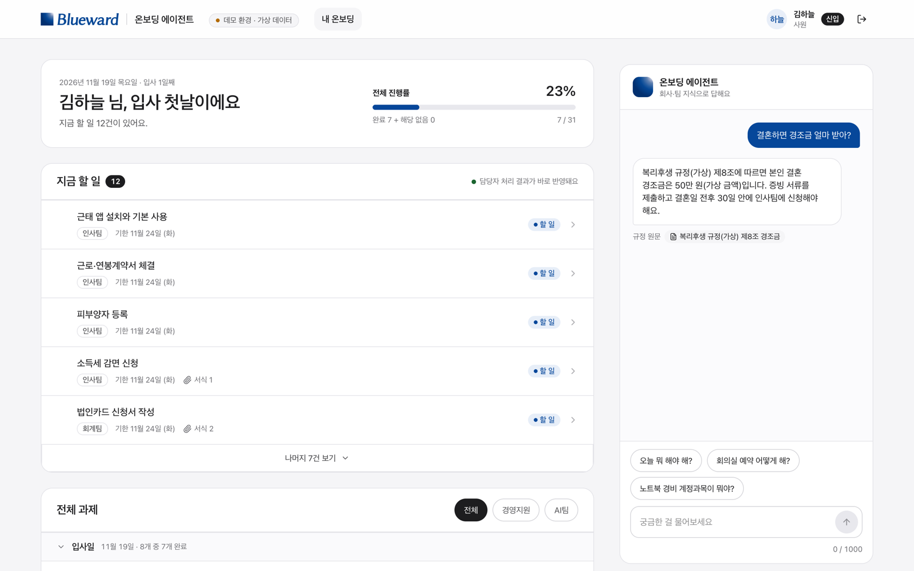
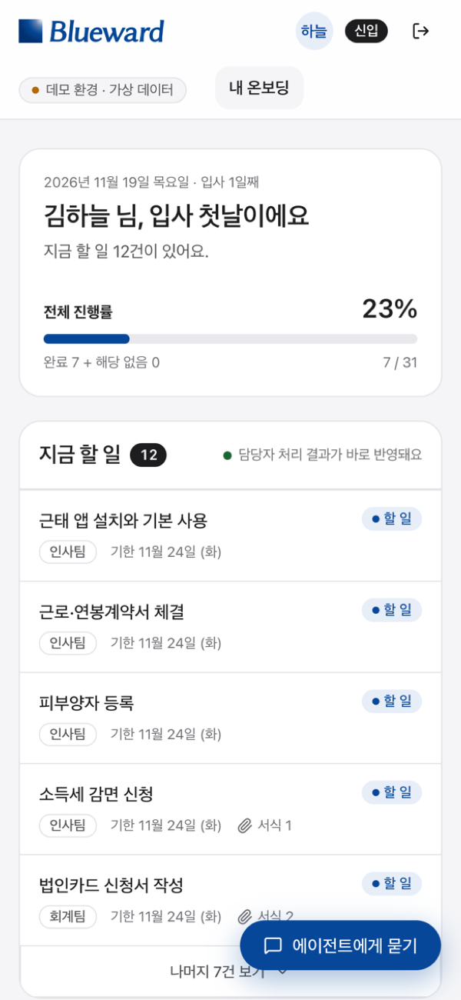
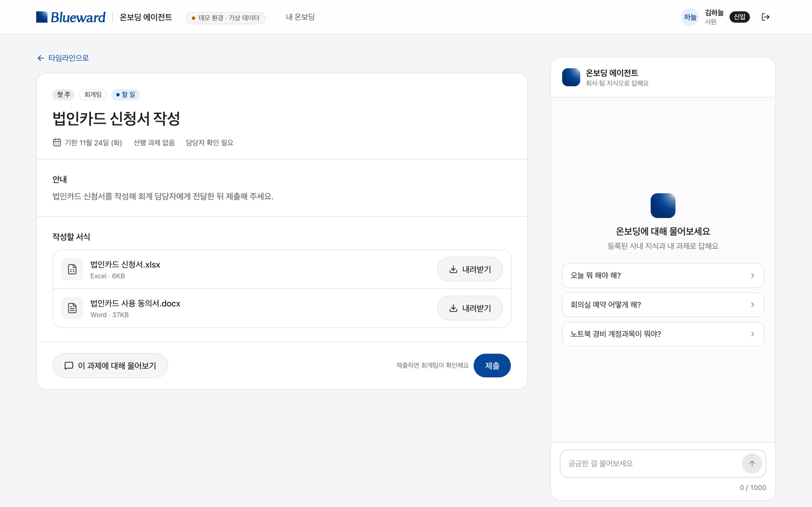
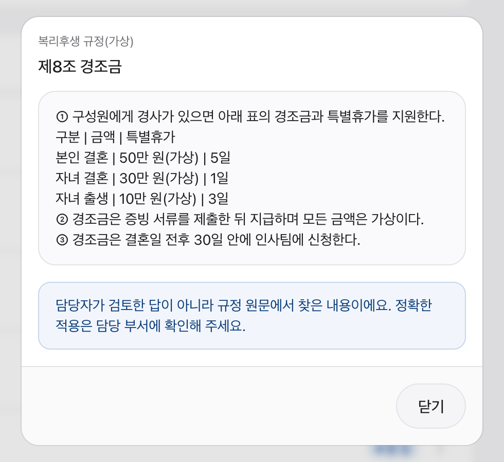
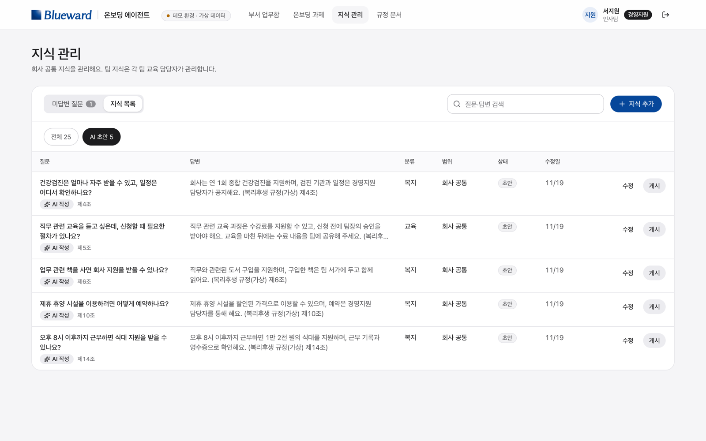
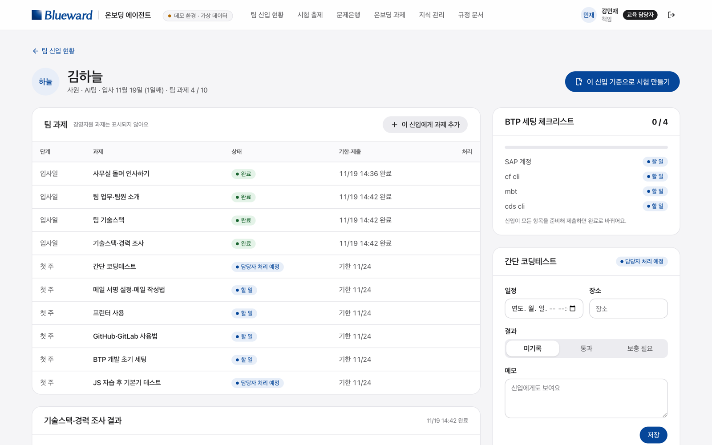
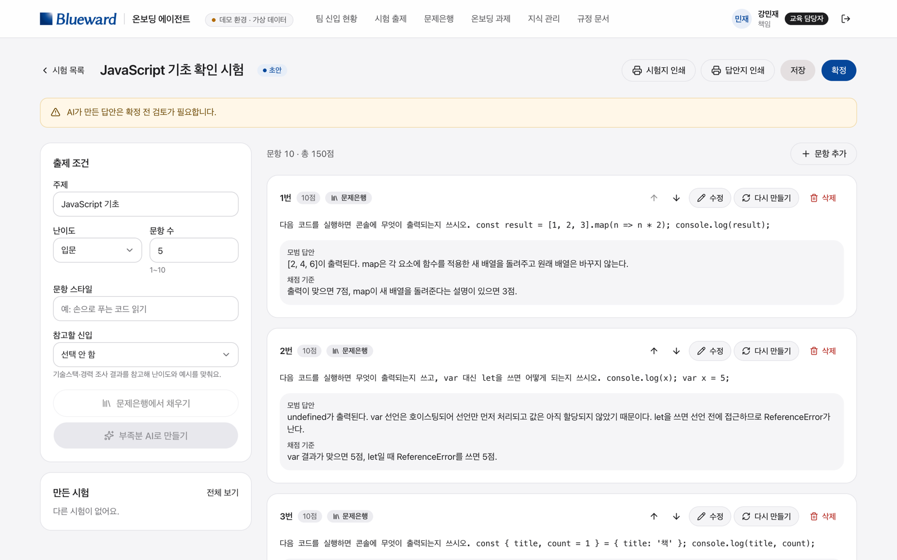
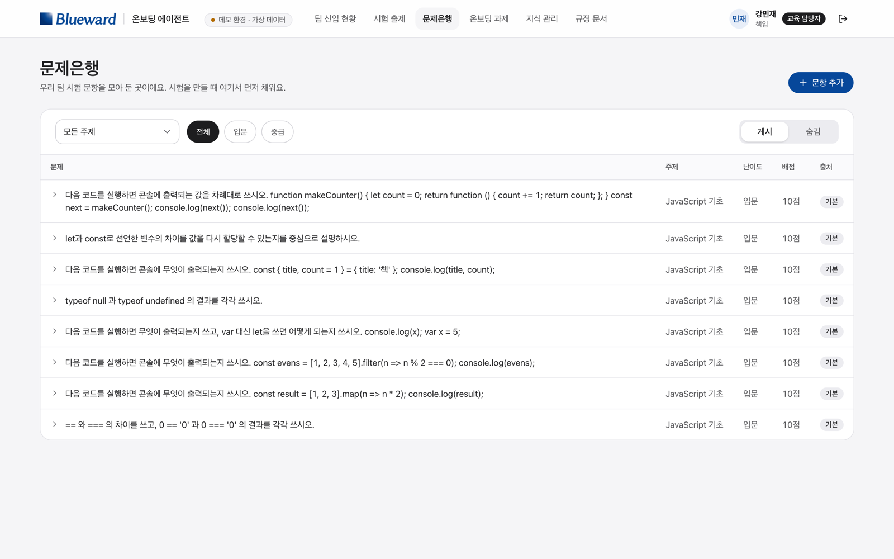

# 온보딩 에이전트

신입 한 명의 온보딩을 하나의 타임라인으로 묶고, 반복되는 질문은 AI 에이전트가 근거와 함께 답하며, 업무 상태는 담당자와 정해진 규칙이 지키는 웹 서비스입니다.

| 운영 버전 | 접속 주소 | 운영 기간 |
|---|---|---|
| `v0.1.0` (2026-11-19) | https://blueward-onboarding.web.app | 2026-11-19 ~ 2026-12-19 |

사내 AI Agent 경진대회 출품작입니다. 화면은 회사 CI(Blueward)를 쓰지만 사람·계정·과제·지식·규정 문서는 모두 가상 데이터입니다. 역할별 계정과 체험 순서는 [심사위원 안내](docs/judge-guide.md)에 있습니다.

운영 v0.1.0 화면입니다. 신입이 "결혼하면 경조금 얼마 받아?"라고 묻자, 에이전트가 담당자가 올린 복리후생 규정(가상) 제8조를 근거로 답하고 "규정 원문" 출처를 붙였습니다. 이 문서의 화면은 모두 운영 환경에서 가상 데이터로 찍었습니다.

## 왜 만들었나

입사 첫 달의 안내는 인사·총무·회계와 팀 교육으로 흩어져 있고, 담당자는 같은 설명을 반복합니다. 이 서비스에서는 네 역할(신입·경영지원·교육 담당자·관리자)이 한 곳에서 과제를 주고받고, 반복 질문에 대한 답과 시험·지식 초안 작성은 AI 에이전트가 맡습니다. 과제 완료나 지식 게시 같은 결정은 사람이 합니다.

## 역할별 핵심 기능

| 역할 | 핵심 기능 | 메뉴 |
|---|---|---|
| **신입** | 단계별 타임라인과 과제 제출, 서식 내려받기, 근거를 보여 주는 AI 채팅, 모르는 질문은 담당자에게 등록 요청 | 내 온보딩 |
| **경영지원** (인사·총무·회계) | 부서 업무함에서 확인·보완 요청, 회사 공통 규정 문서 올리기와 AI 지식 초안, 부서 온보딩 과제·서식 관리 | 부서 업무함 · 온보딩 과제 · 지식 관리 · 규정 문서 |
| **교육 담당자** | 팀 신입 진행·평가 관리, 문제은행 우선 시험 출제와 AI 부족분 생성, 미답변 질문에 규정 근거 답 초안, 팀 과제·서식 관리 | 팀 신입 현황 · 시험 출제 · 문제은행 · 온보딩 과제 · 지식 관리 · 규정 문서 |
| **관리자** | 계정 등록(신입은 온보딩 과제 자동 생성), 데모 데이터 초기화 | 사용자 관리 |

### 신입: 오늘 할 일과 궁금한 것을 한 화면에서

- **타임라인**: 경영지원 과제 21개와 팀 과제 10개(총 31개)를 입사일·첫 주·첫 달로 나눠 보여 줍니다. 선행 과제가 끝나면 다음 과제가 열리고, 담당자 처리 결과는 새로고침 없이 반영됩니다.
- **과제 제출과 서식**: 과제 상세에서 담당자가 올린 서식(Word·Excel·PDF)을 내려받고, 다 하면 제출합니다. 서류 원본은 받지 않고 제출 여부만 확인합니다.
- **AI 채팅**: 게시된 사내 지식, 규정 문서 조항, 본인 과제만 근거로 답하고 출처를 붙입니다. 근거가 없으면 지어내지 않고 "확인되지 않은 내용이에요."라고 답하며, 신입이 원할 때만 "담당자에게 등록 요청"으로 질문을 넘깁니다.
- **모바일**: 신입 화면은 휴대폰 폭에서도 쓸 수 있습니다.

 

  
  

왼쪽: 과제 상세에서 작성할 서식을 내려받습니다. 오른쪽: 채팅 답변 아래 "규정 원문"을 누르면 근거 조항의 원문이 열립니다.

### 경영지원(인사·총무·회계): 우리 부서 일만, 정해진 규칙대로

- **부서 업무함**: 우리 부서 과제만 보입니다. 신입이 제출한 내용을 확인해 완료 처리하거나, 사유를 적어 보완을 요청합니다. 담당자가 직접 처리하는 과제(출입 등록 등)도 여기서 완료합니다.
- **규정 문서**: 회사 공통 규정 문서(docx·pdf)를 올리면 조항으로 나눠 두고, 신입 채팅이 그 조항을 근거로 답합니다. "지식 초안 만들기"를 누르면 조항을 근거로 한 질문·답 초안을 5개까지 만들고, 담당자가 지식 관리에서 "AI 작성" 표시를 확인한 뒤 게시합니다.
- **온보딩 과제**: 부서 과제를 추가·수정·보관하고 서식을 붙입니다. 진행 중인 신입이 있는 과제는 제목과 안내문만 고칠 수 있고, 새 과제는 이후 온보딩을 시작하는 신입부터 들어갑니다. 특정 신입 한 명에게만 과제를 더할 수도 있습니다.

  
  

  
  

위 왼쪽부터 부서 업무함(제출 내용 확인·보완 요청), 규정 문서(조항 목록과 지식 초안 만들기), 지식 관리의 AI 초안(근거 조항 표시, 게시 전), 온보딩 과제(사용 중 잠금과 서식).

### 교육 담당자: 팀 신입 관리와 AI 출제 도우미

- **팀 신입 현황**: 팀 과제 진행률과 평가 일정을 보고, 신입 상세에서 평가 결과를 기록하거나 그 신입에게만 과제를 더합니다.
- **시험 출제**: 주제·난이도·문항 수를 넣으면 팀 문제은행에서 먼저 채우고, 모자란 만큼만 AI가 문제·모범 답안·채점 기준 초안을 만듭니다. 신입의 기술스택 조사 결과를 참고할 수 있고, 확정한 문항은 문제은행에 쌓입니다. 시험지와 답안지는 따로 인쇄하며, 평가 과제에 연결한 시험의 문항은 그 신입의 다음 시험에서 빠집니다.
- **미답변 질문에 답하기**: 신입이 등록을 요청한 질문을 열고 "규정에서 답 초안 찾기"를 누르면 규정 조항을 근거로 한 답 초안이 채워집니다. 확인 후 게시하면 다음부터 채팅이 바로 답합니다.

  
  

  
  

위 왼쪽부터 신입 상세, 시험 편집(문제은행 8문항 + AI 부족분), 문제은행, 미답변 질문의 규정 근거 답 초안.

### 관리자: 계정과 시연 환경

- **계정 등록**: 역할·팀·입사일·초기 비밀번호를 정해 계정을 만듭니다. 신입은 등록하는 즉시 온보딩 과제가 준비됩니다. 공개 가입은 없고, 관리자 계정은 화면에서 만들 수 없습니다.
- **데모 데이터 초기화**: 기본 계정의 진행 상황·지식·미답변·시험·문제은행·온보딩 과제를 처음 상태로 되돌립니다. 관리자가 만든 계정은 그대로 남습니다.

## AI가 하는 일과 사람이 하는 일

| AI 에이전트 | 사람(담당자) |
|---|---|
| 지식·규정 조항·본인 과제를 근거로 답하고 출처 표시, 근거가 없으면 모른다고 답함 | 미답변 질문에 답을 등록하고 게시 |
| 시험 문항, 지식 질문·답 초안 작성 | 초안 검토·수정 후 확정·게시 |
| 올린 규정 문서를 조항으로 나눠 검색에 사용 | 문서 올리기·지우기 |
| 업무 상태를 바꾸는 기능 없음 | 과제 확인·보완 요청·완료 처리 |

## 믿고 쓸 수 있게 한 장치

- **업무 상태는 규칙으로만 바뀝니다.** 과제 완료·보완 요청은 화면에서 사람이 누르고, 데이터베이스에 정한 규칙을 거쳐서만 처리됩니다. AI가 잘못 판단해도 진행 상황이 바뀌지 않습니다.
- **역할별로 볼 수 있는 범위가 정해져 있습니다.** 신입은 본인 과제만, 경영지원 담당자는 자기 부서 과제만, 시험과 문제은행은 같은 팀 교육 담당자만 봅니다. 계정은 관리자만 만듭니다.
- **AI 사용에는 상한이 있습니다.** 사용자당 하루 채팅 50회, 시험 생성 10회, 규정 문서 처리 20회, 초안 생성 30회까지입니다. 채팅 내용은 저장하지 않습니다.
- **올릴 수 있는 파일은 가상 서식과 가상 규정 문서뿐입니다.** docx·xlsx·pdf, 10MB 이하이고, 업로드 화면마다 실제 문서와 개인정보를 올리지 말라고 안내합니다.
- **운영은 개발과 분리돼 있습니다.** 스테이징에서 확인한 버전만 승인을 거쳐 운영에 올라가고(현재 `v0.1.0`), 배포할 때마다 로그인·권한·화면을 자동으로 점검합니다. 공개 기간 동안 첫 접속이 느려지지 않도록 서비스를 계속 켜 둡니다.

## 만든 방식

기획·결정·승인은 사람이 맡고, 구현과 리뷰는 AI 에이전트가 나눠 처리했습니다. Claude Code가 공통 기반을 먼저 만든 뒤 신입·담당자·채팅·시험·과제 관리·규정 문서 기능을 여러 세션이 나눠 병렬로 개발했고, 기능마다 테스트를 먼저 작성했습니다. 모든 변경은 Codex의 코드 리뷰를 통과한 뒤 반영했습니다. 공개 전에는 시연 흐름 전체와 실패 상황(접근 차단, 권한, 장애 시 동작)을 실제 화면에서 점검했고, 결과는 [시연 스크립트](docs/demo-script.md)에 정리했습니다.

## 확장 계획

| 방향 | 방법 |
|---|---|
| 회사 계정 로그인 | Microsoft 계정(Azure)으로 로그인 |
| Teams에서 묻기 | Teams 봇이 같은 에이전트를 호출 |
| 여러 조직 | 조직별로 데이터를 나눠 계열사·다른 부서로 확대 |
| 입사 전·퇴사 절차 | 같은 과제 구조에 단계를 추가 |

## 더 보기

| 문서 | 내용 |
|---|---|
| [심사위원 안내](docs/judge-guide.md) | 접속, 역할별 계정, 5분 체험 순서, 사용 한도 |
| [시연 스크립트](docs/demo-script.md) | 시연 흐름과 기대 결과, 점검 기록 |
| [구조와 개발 안내](docs/architecture.md) | 아키텍처, 데이터 모델, 보안·권한, 배포, 기술 스택, 로컬 실행(개발자용) |
| [배포 안내](docs/deploy.md) | 환경 구성, 배포 흐름, 되돌리기, 운영 점검(개발자용) |
