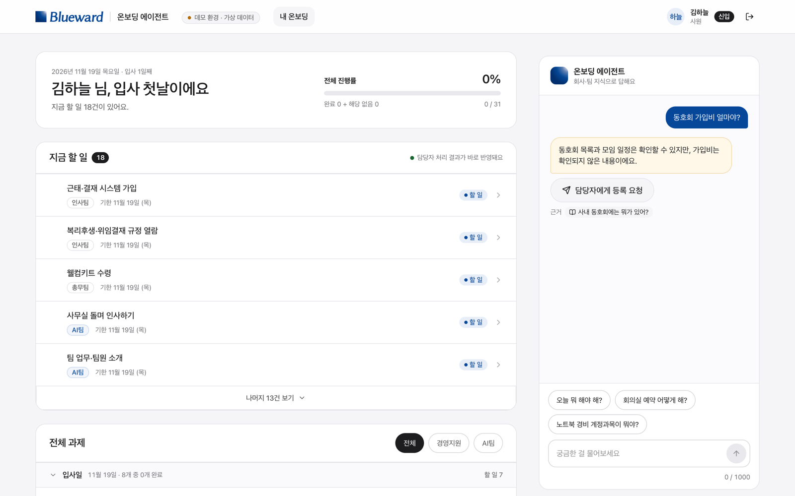
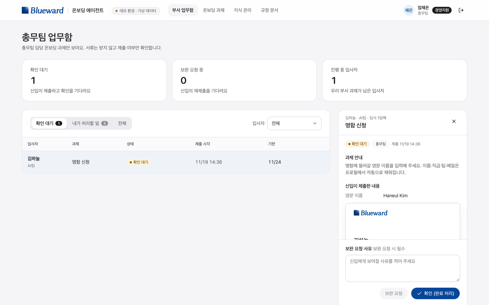
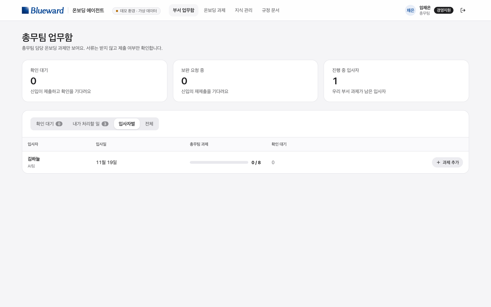
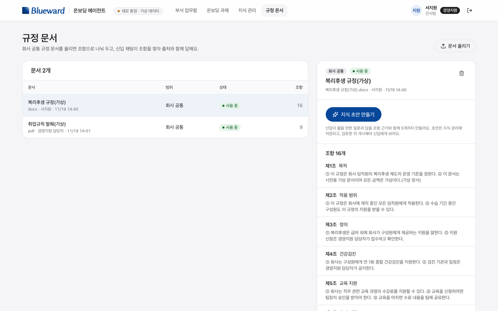
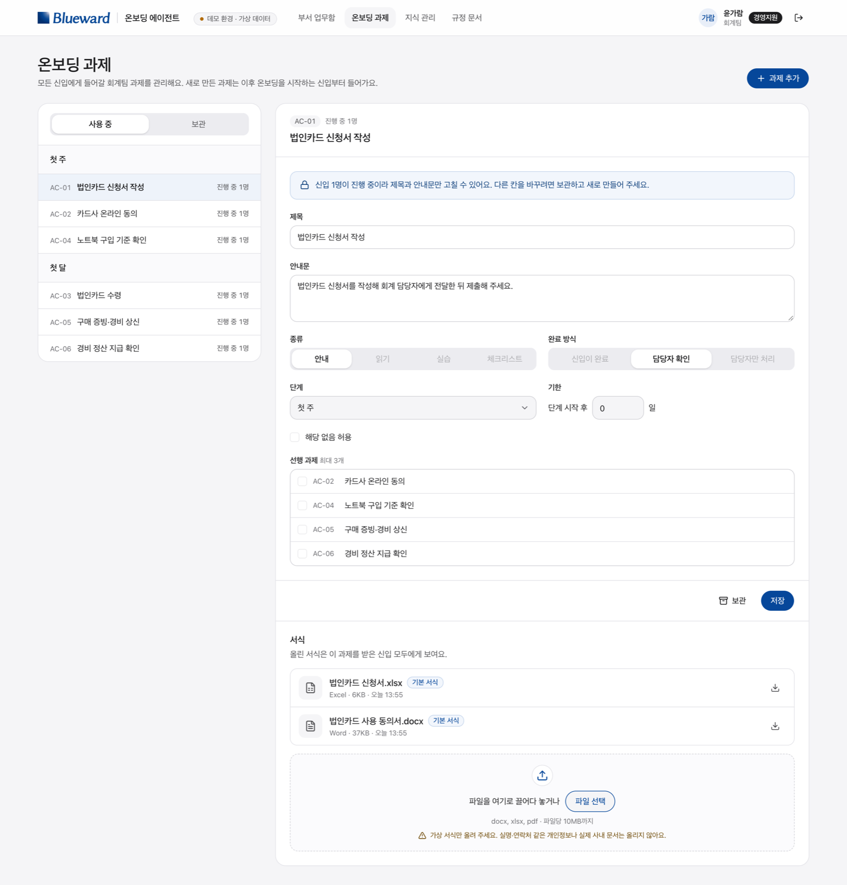
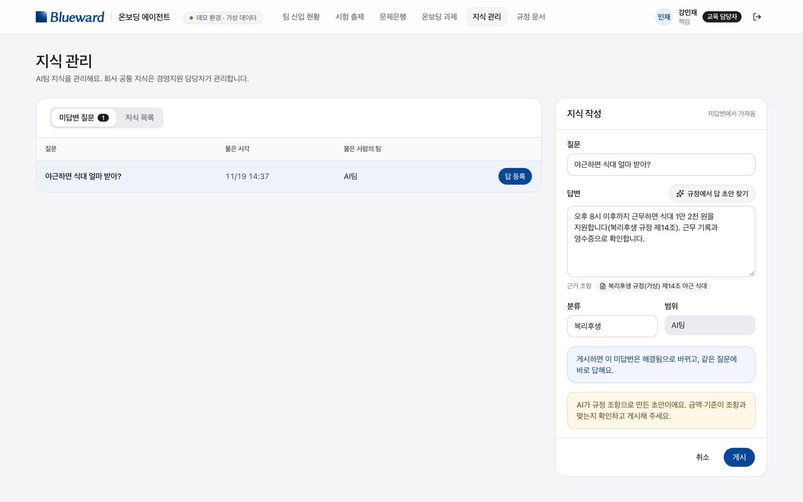
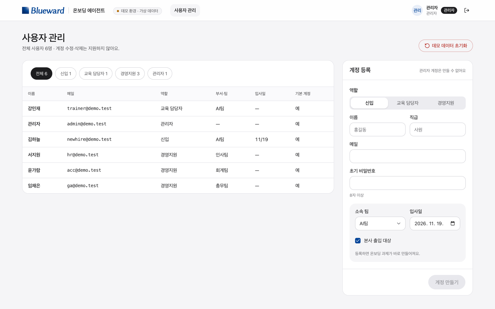
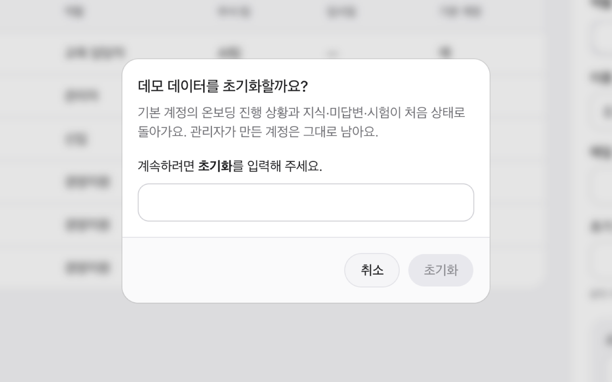
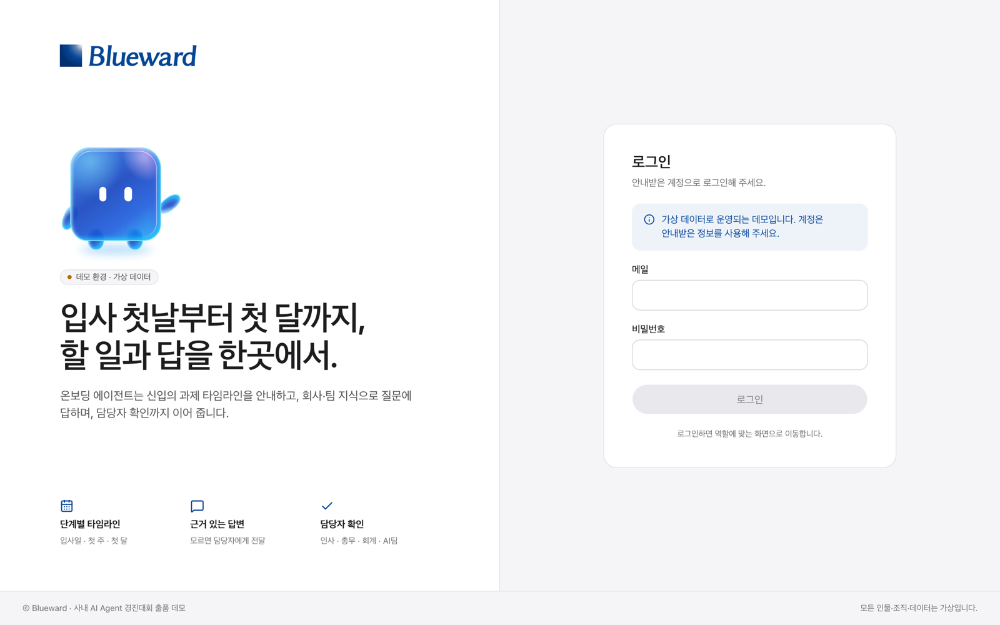
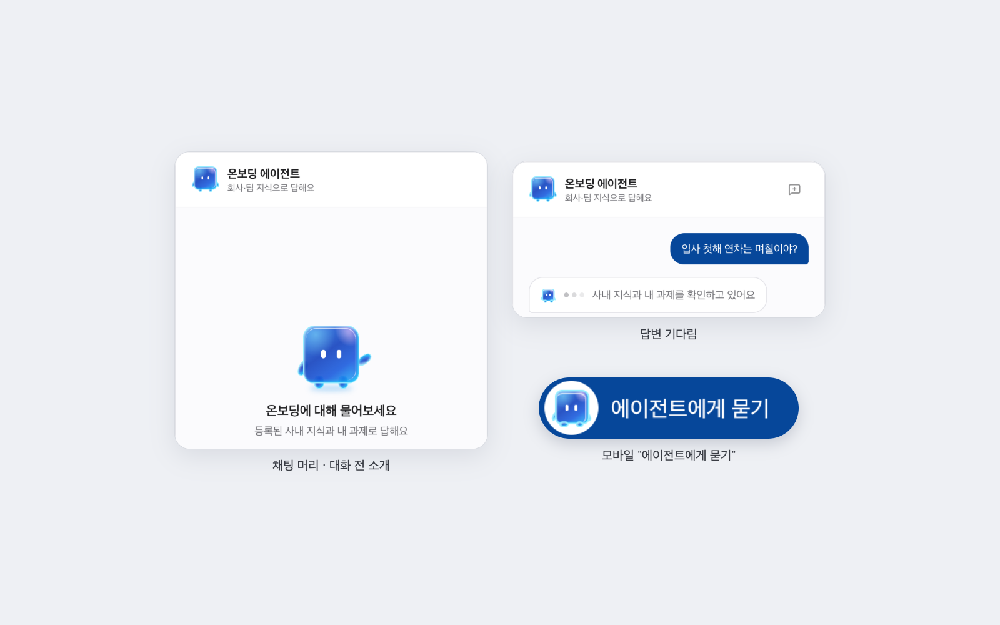

# 온보딩 에이전트

신입 온보딩 과제를 타임라인 하나에 모은 웹 서비스입니다. 반복되는 질문에는 AI 에이전트가 근거를 붙여 답하고, 과제 완료 처리는 담당자가 정해진 규칙에 따라 합니다.

| 운영 버전 | 접속 주소 | 운영 기간 |
|---|---|---|
| `v0.2.0` (2026-11-20) | https://blueward-onboarding.web.app | 2026-11-19 ~ 2026-12-19 |

사내 AI Agent 경진대회 출품작입니다. 화면에는 회사 CI(Blueward)를 썼고, 사람·계정·과제·지식·규정 문서는 전부 가상 데이터입니다. 역할별 계정과 체험 순서는 [심사위원 안내](docs/judge-guide.md)를 보면 됩니다.

운영 v0.2.0 화면. 신입이 "입사 첫해 연차는 며칠이야?"라고 묻자 에이전트가 취업규칙 발췌(가상) 제21조를 찾아 답하고 출처를 달았습니다. 채팅 머리의 젤리 큐브가 온보딩 에이전트입니다. 따로 적지 않은 화면은 모두 운영 환경에서 가상 데이터로 찍었습니다.

## v0.2.0에서 달라진 점

| 구분 | 내용 |
|---|---|
| 새 마스코트 | 온보딩 에이전트의 얼굴로 젤리 큐브 캐릭터를 넣었습니다. 로그인 화면, 채팅, 모바일 "에이전트에게 묻기" 버튼, 모든 과제 완료 화면, 브라우저 탭 아이콘에 나옵니다([아래](#에이전트-마스코트)) |
| 채팅 "새 대화" | 신입 채팅 위쪽의 "새 대화" 버튼으로 새로고침 없이 대화를 비우고 처음부터 물을 수 있습니다. 대화는 저장하지 않으므로 누르기 전에 한 번 확인합니다 |
| 업무함 "입사자별" 탭 | 경영지원 담당자가 부서 업무함에서 신입별 진행률과 확인 대기를 보고, 신입 줄의 "과제 추가"로 그 신입에게만 과제를 줍니다 |
| 모바일 화면 | 휴대폰 폭(360·390px)에서 모든 화면이 가로로 밀리지 않게 고쳤습니다. 좁은 화면에서는 표의 보조 칸을 제목 아래 한 줄로 옮깁니다 |
| 규정 문서 올리기 | 문서 이름을 먼저 입력하고 파일을 골라도 입력한 이름이 유지됩니다(전에는 파일 이름으로 덮어써짐) |

## 왜 만들었나

입사 첫 달 안내는 인사·총무·회계와 팀 교육이 제각각 하다 보니, 담당자는 같은 설명을 신입마다 되풀이합니다. 그래서 신입과 경영지원, 교육 담당자, 관리자가 한곳에서 과제를 주고받게 했습니다. 반복 질문에 답하고 시험·지식 초안을 쓰는 일은 AI 에이전트가 맡고, 과제 완료와 지식 게시는 사람이 결정합니다.

## 역할별 핵심 기능

| 역할 | 핵심 기능 | 메뉴 |
|---|---|---|
| **신입** | 단계별 타임라인과 과제 제출, 서식 내려받기, 근거를 보여 주는 AI 채팅, 모르는 질문은 담당자에게 등록 요청 | 내 온보딩 |
| **경영지원** (인사·총무·회계) | 부서 업무함에서 확인·보완 요청, 회사 공통 규정 문서 올리기와 AI 지식 초안, 부서 온보딩 과제·서식 관리 | 부서 업무함 · 온보딩 과제 · 지식 관리 · 규정 문서 |
| **교육 담당자** | 팀 신입 진행·평가 관리, 문제은행 우선 시험 출제와 AI 부족분 생성, 미답변 질문에 규정 근거 답 초안, 팀 과제·서식 관리 | 팀 신입 현황 · 시험 출제 · 문제은행 · 온보딩 과제 · 지식 관리 · 규정 문서 |
| **관리자** | 계정 등록(신입은 온보딩 과제 자동 생성), 데모 데이터 초기화 | 사용자 관리 |

### 신입

입사일·첫 주·첫 달로 나뉜 타임라인에 경영지원 과제 21개와 팀 과제 10개가 들어 있습니다. 앞 과제를 끝내야 다음 과제가 열리고, 담당자가 확인하면 새로고침하지 않아도 화면에 반영됩니다. 궁금한 건 오른쪽 채팅에 물으면 됩니다.

- 과제 상세에서 Word·Excel·PDF 서식을 내려받아 작성 후 제출. 원본 서류는 받지 않고 제출 여부만 확인
- 채팅은 게시된 사내 지식, 규정 문서 조항, 본인 과제만 근거로 쓰고 출처를 표시. 근거가 없으면 "확인되지 않은 내용이에요."라고 답하고, 담당자에게 넘길지는 신입이 정함
- "새 대화" 버튼으로 대화를 비우고 다시 시작. 대화 내용은 어디에도 저장하지 않음
- 휴대폰 화면 지원(채팅은 마스코트가 붙은 "에이전트에게 묻기" 버튼)

<table>
  <tr>
    <td width="50%"> 과제 상세: 담당자가 붙인 서식을 내려받고 제출</td>
    <td width="50%"> 답변 아래 "규정 원문"을 누르면 근거 조항 원문이 열림</td>
  </tr>
  <tr>
    <td width="50%"> 근거가 없으면 지어내지 않고, 신입이 원하면 담당자에게 등록 요청</td>
    <td width="50%"> 모바일: 지금 할 일과 "에이전트에게 묻기", 채팅(등록된 지식 근거)</td>
  </tr>
</table>

### 경영지원 (인사·총무·회계)

부서 업무함에는 우리 부서 과제만 보입니다. 신입이 낸 내용을 보고 완료 처리하거나 사유를 적어 보완을 요청하고, 출입 등록처럼 담당자가 직접 처리하는 과제도 여기서 끝냅니다.

- 회사 공통 규정 문서(docx·pdf)를 올리면 조항 단위로 나뉘어 신입 채팅의 근거가 됨
- "지식 초안 만들기"로 조항 근거 질문·답 초안을 5개까지 생성. 검토하고 게시해야 신입에게 보임
- 온보딩 과제 화면에서 부서 과제를 추가·수정·보관하고 서식 첨부. 진행 중인 신입이 있으면 제목과 안내문만 수정 가능하고, 새 과제는 그 뒤에 시작하는 신입부터 적용
- "입사자별" 탭에서 신입마다 우리 부서 과제 진행률과 확인 대기를 보고, 그 줄의 "과제 추가"로 그 신입에게만 과제 추가

<table>
  <tr>
    <td width="50%"> 부서 업무함: 제출 내용을 보고 확인(완료 처리) 또는 보완 요청(v0.1.0 화면)</td>
    <td width="50%"> 입사자별 탭: 신입별 진행률을 보고 그 줄에서 "과제 추가"</td>
  </tr>
  <tr>
    <td width="50%"> 규정 문서: 올린 문서를 조항으로 나누고 "지식 초안 만들기"</td>
    <td width="50%"> 지식 관리: 근거 조항이 붙은 "AI 작성" 초안을 검토하고 게시</td>
  </tr>
  <tr>
    <td width="50%"> 온보딩 과제: 진행 중인 신입이 있으면 제목·안내문만 수정</td>
    <td width="50%"></td>
  </tr>
</table>

### 교육 담당자

팀 신입 현황에서 팀 과제 진행률과 평가 일정을 보고, 신입 상세에서 평가 결과를 기록합니다. 시험을 만들 때 주제·난이도·문항 수를 정하면 팀 문제은행 문항이 먼저 채워지고, 모자란 만큼만 AI가 문제와 모범 답안, 채점 기준 초안을 씁니다.

- 신입이 낸 기술스택 조사 결과를 참고해 출제 가능. 확정한 문항은 문제은행에 쌓임
- 시험지와 답안지를 나눠 인쇄. 평가 과제에 연결한 시험의 문항은 그 신입의 다음 시험에서 제외
- 미답변 질문에서 "규정에서 답 초안 찾기"를 누르면 조항 근거 답 초안이 채워짐. 게시한 뒤부터 채팅이 그 질문에 답함
- 신입 한 명에게만 과제 추가 가능

<table>
  <tr>
    <td width="50%"> 신입 상세: 팀 과제 진행, 평가 기록, 이 신입에게 과제 추가</td>
    <td width="50%"> 시험 편집: 문제은행 8문항을 먼저 채우고 부족분만 AI 초안</td>
  </tr>
  <tr>
    <td width="50%"> 문제은행: 확정한 문항이 쌓이고, 고치거나 숨기거나 직접 추가</td>
    <td width="50%"> 미답변 질문: "규정에서 답 초안 찾기"로 조항 근거 답 초안</td>
  </tr>
</table>

### 관리자

계정은 관리자가 역할·팀·입사일·초기 비밀번호를 정해 만듭니다. 신입 계정을 만들면 온보딩 과제가 함께 생기고, 공개 가입은 없습니다.

- 관리자 계정은 화면에서 만들 수 없음
- 데모 데이터 초기화로 기본 계정의 진행 상황·지식·미답변·시험·문제은행·온보딩 과제를 초기 상태로 되돌림. 관리자가 만든 계정은 유지

<table>
  <tr>
    <td width="50%"> 사용자 관리: 계정 목록과 계정 등록(신입은 입사일 기준 과제 생성)</td>
    <td width="50%"> 데모 데이터 초기화: "초기화"를 입력해야 실행</td>
  </tr>
</table>

## 에이전트 마스코트

v0.2.0부터 반투명한 파란 젤리 큐브가 온보딩 에이전트의 얼굴로 등장합니다. 에이전트가 있는 자리에만 나오므로, 신입은 "여기에 물어보면 된다"는 것을 바로 알 수 있습니다. 회사 로고와 대표색은 그대로 두고, 마스코트가 CI를 대신하지 않습니다.

| 포즈 | 뜻 | 나오는 곳 |
|---|---|---|
| 서 있기 | 에이전트 | 채팅 머리 |
| 손 흔들기 | 환영·완료 | 로그인 화면, 채팅 대화 전 소개, 모든 과제를 끝낸 신입 홈 |
| 앉기 | 버튼·기다림 | 모바일 "에이전트에게 묻기" 버튼, 답변을 기다리는 말풍선 |

- 이미지 파일이 아니라 CSS로 그려서 크기가 달라도 선명합니다. 브라우저 탭 아이콘과 휴대폰 홈 화면 아이콘도 같은 디자인입니다.
- 로그인 화면과 채팅 대화 전 소개처럼 크게 나오는 자리에서는 살짝 움직이고, 로그인 화면의 마스코트는 누르면 튀어 오릅니다. 기기에서 동작 줄이기를 켜면 움직이지 않습니다.
- 장식용이라 화면 읽기 프로그램은 읽지 않고, 키보드 초점도 받지 않습니다.

<table>
  <tr>
    <td width="50%"> 로그인 화면: 넓은 화면에서 손을 흔드는 마스코트(누르면 튐)</td>
    <td width="50%"> 채팅 머리·대화 전 소개, 답변 기다림, 모바일 "에이전트에게 묻기"</td>
  </tr>
</table>

## AI가 하는 일과 사람이 하는 일

| AI 에이전트 | 사람(담당자) |
|---|---|
| 지식·규정 조항·본인 과제를 근거로 답하고 출처 표시, 근거가 없으면 모른다고 답함 | 미답변 질문에 답을 등록하고 게시 |
| 시험 문항, 지식 질문·답 초안 작성 | 초안 검토·수정 후 확정·게시 |
| 올린 규정 문서를 조항으로 나눠 검색에 사용 | 문서 올리기·지우기 |
| 업무 상태를 바꾸는 기능 없음 | 과제 확인·보완 요청·완료 처리 |

## 권한과 안전장치

과제 완료와 보완 요청은 사람이 화면에서 누른 것만 데이터베이스에 정해 둔 규칙을 거쳐 처리됩니다. 에이전트에는 업무 상태를 바꾸는 기능이 없으니, AI가 잘못 판단하더라도 진행 상황은 그대로입니다. 보는 범위도 역할마다 달라서 신입은 본인 과제만, 경영지원 담당자는 자기 부서 과제만 봅니다. 시험과 문제은행은 같은 팀 교육 담당자만 열 수 있고 계정은 관리자만 만듭니다.

AI는 사용자 한 명이 하루에 채팅 50회, 시험 생성 10회, 규정 문서 처리 20회, 초안 생성 30회까지 쓸 수 있고, 채팅 내용은 저장하지 않습니다. 올릴 수 있는 파일은 가상 서식과 가상 규정 문서뿐입니다. docx·xlsx·pdf 형식에 10MB까지 받으며, 업로드 화면마다 실제 문서나 개인정보를 올리지 말라는 안내를 붙였습니다.

심사위원이 쓰는 운영 환경은 개발 환경과 분리했습니다. 스테이징에서 확인한 버전만 승인을 거쳐 올라가고, 지금은 v0.2.0입니다. 배포할 때마다 로그인과 권한, 화면을 자동으로 점검하며 공개 기간에는 첫 접속이 느리지 않게 서버를 켜 둡니다.

## 확장 계획

| 방향 | 방법 |
|---|---|
| 회사 계정 로그인 | Microsoft 계정(Azure)으로 로그인 |
| Teams에서 묻기 | Teams 봇이 같은 에이전트를 호출 |
| 여러 조직 | 조직별로 데이터를 나눠 계열사·다른 부서로 확대 |
| 입사 전·퇴사 절차 | 같은 과제 구조에 단계를 추가 |

## 더 보기

| 문서 | 내용 |
|---|---|
| [심사위원 안내](docs/judge-guide.md) | 접속, 역할별 계정, 5분 체험 순서, 사용 한도 |
| [시연 스크립트](docs/demo-script.md) | 시연 흐름과 기대 결과, 점검 기록 |
| [구조와 개발 안내](docs/architecture.md) | 아키텍처, 데이터 모델, 보안·권한, 배포, 기술 스택, 로컬 실행(개발자용) |
| [배포 안내](docs/deploy.md) | 환경 구성, 배포 흐름, 되돌리기, 운영 점검(개발자용) |
