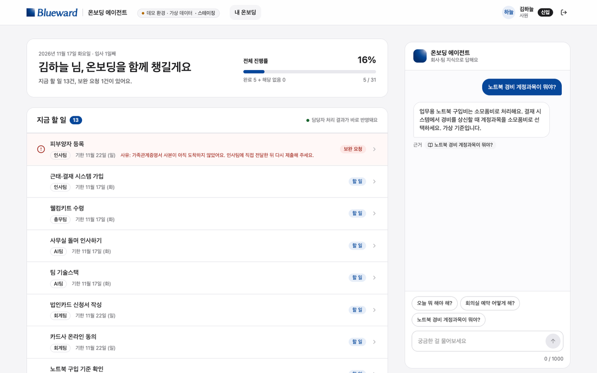
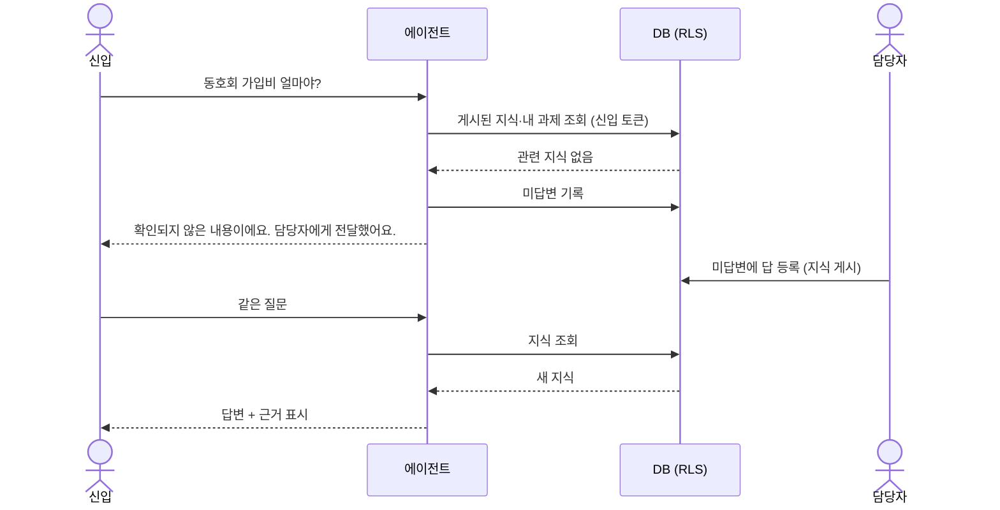
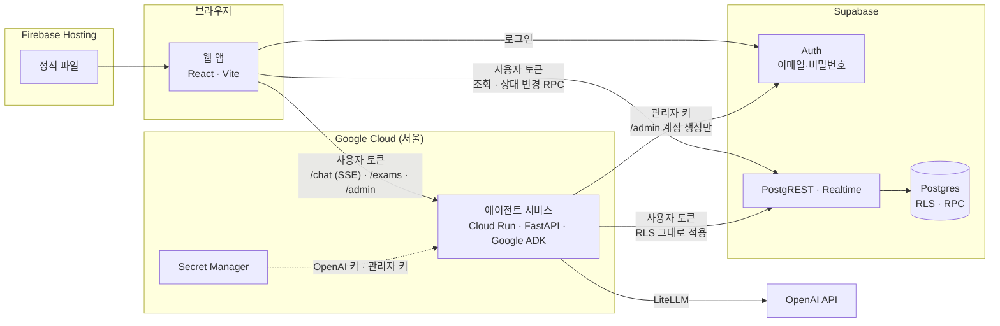
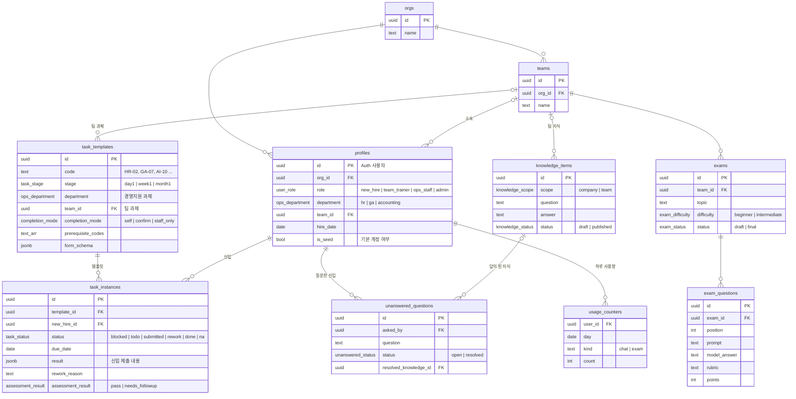
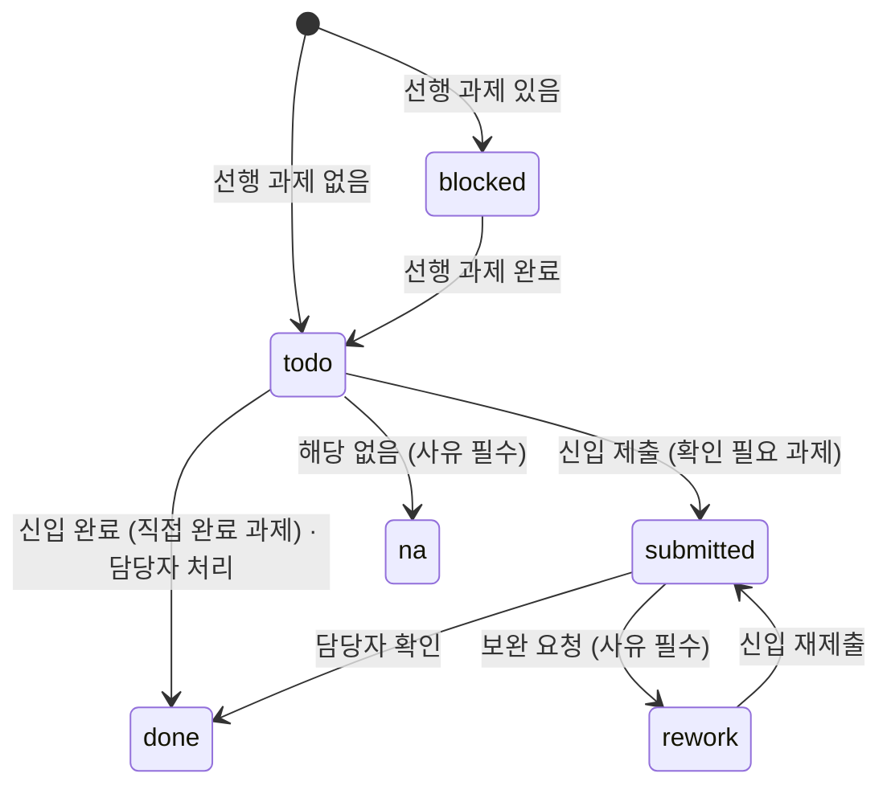

# 온보딩 에이전트

신입 한 명의 온보딩을 하나의 타임라인으로 묶고, 문서에 없는 질문과 반복 설명은 AI 에이전트가 받되, 업무 상태는 사람과 규칙이 지키는 웹 서비스입니다.

| 구분 | 내용 |
|---|---|
| 문제 | 인사·총무·회계 안내와 팀 교육이 따로 전달되고, 담당자는 같은 설명을 반복한다 |
| 해결 | 역할 4개(신입·교육 담당자·경영지원·관리자)가 한 서비스에서 과제를 주고받고, 에이전트가 지식 답변과 시험 초안을 맡는다 |
| 차별점 | 근거를 표시하고 모르면 담당자에게 넘기는 에이전트, 과제 상태는 DB 규칙만 바꾸는 구조, 공개 URL로 실제 운영 |

사내 AI Agent 경진대회 출품작입니다. 화면은 회사 CI(Blueward)를 쓰고, 사람·계정·과제·지식 데이터는 모두 가상입니다. 심사위원 접속 안내는 [심사위원 안내](docs/judge-guide.md)에 있습니다.



<p>
  
  
</p>

위: 신입 타임라인과 채팅(근거 표시). 아래 왼쪽: 경영지원 업무함에서 제출 확인·보완 요청. 아래 오른쪽: 교육 담당자의 시험 초안 편집. 모두 스테이징 화면이며 데이터는 가상입니다.

## 주요 기능

| 역할 | 기능 |
|---|---|
| 신입 | 입사일·첫 주·첫 달 타임라인에서 경영지원 과제 21개와 팀 과제 10개를 처리한다. 선행 과제가 끝나면 다음 과제가 열리고, 담당자 처리 결과가 새로고침 없이 반영된다. 오른쪽 채팅에서 에이전트에게 묻는다 |
| 경영지원 (인사·총무·회계) | 부서 업무함에서 제출된 과제를 확인하거나 사유와 함께 보완을 요청하고, 담당자 처리 과제를 완료한다 |
| 교육 담당자 | 팀 신입의 진행과 평가 일정을 보고 결과를 기록한다. 미답변 질문에 답을 등록하고, AI 초안으로 시험지와 답안지를 만든다 |
| 관리자 | 계정을 등록하면(신입은 입사일 기준) 온보딩 과제 31개가 바로 만들어진다. 시연용 데이터를 초기 상태로 되돌린다 |

### 온보딩 어시스턴트 (신입용 채팅)


- 게시된 사내 지식과 신입 본인의 과제만 근거로 답하고, 답 아래에 **근거**(사용한 지식·과제)를 표시한다.
- 근거가 없으면 지어내지 않고 "확인되지 않은 내용이에요. 담당자에게 전달했어요."라고 답하며 미답변으로 기록한다.
- 담당자가 그 질문에 답을 등록하면 다음 질문부터 바로 답한다(지식 순환).
- "오늘 할 일"은 신입이 직접 할 과제만 안내하고, 담당자가 처리할 과제는 구분해서 말한다.
- 과제 완료 같은 상태 변경 요청은 할 수 없다고 안내하고 해당 과제 화면으로 연결한다. 코드 작성·시험 답안 요청은 거절한다.

오른쪽 화면: 질문하면 답이 실시간으로 이어서 나오고 아래에 근거 지식이 붙는다(첫 응답까지의 대기 시간은 줄여서 편집).
<br clear="right">

### 시험 출제 도우미 (교육 담당자용)
- 주제·난이도·문항 수를 넣으면 문제·모범 답안·채점 기준·배점 초안을 구조화된 형식으로 받는다. 신입이 제출한 기술스택 조사 결과를 참고할 수 있다.
- 문항 하나만 다시 만들거나 직접 고치고, 순서를 바꿔 저장한다. AI 초안은 확정 전 검토가 필요하다고 표시한다.
- 시험지(답 없음)와 답안지(모범 답안·채점 기준)를 따로 인쇄하거나 PDF로 저장한다. 신입은 시험 문제와 답안을 볼 수 없다.



## 아키텍처

업무 규칙(과제 상태 전이, 권한)은 DB가 지키고, 에이전트는 조회·답변·초안만 맡는 **업무 엔진 + 얇은 에이전트** 구조입니다. LLM이 잘못 판단해도 업무 상태가 망가지지 않습니다.



| 구성 | 역할 |
|---|---|
| 웹 앱 | 역할별 화면. 데이터는 사용자 토큰으로 Supabase에서 직접 읽고, 과제 상태는 RPC로만 바꾼다. 실시간 구독으로 다른 사람의 처리 결과가 바로 반영된다 |
| Supabase | 인증, 데이터, 업무 규칙. 모든 테이블에 RLS를 걸어 역할·부서·팀·본인 범위만 보이게 한다. 공개 가입은 막는다 |
| 에이전트 서비스 | 채팅(SSE 스트리밍), 시험 초안, 관리자 계정 생성 API. 사용자 토큰으로 조회해 RLS가 그대로 적용되고, 상태가 없다(대화 이력은 요청에 담겨 오며 저장하지 않는다) |
| LLM | OpenAI, 모델 이름은 환경변수로 바꾼다. ADK + LiteLLM으로 연결해 특정 모델 전용 기능에 기대지 않는다 |

## 데이터 모델

모든 테이블에 `org_id`가 있어 여러 조직으로 넓힐 수 있습니다(그림에서는 조직 연결을 일부만 표시).



과제 상태는 아래 규칙대로만 바뀌며, 모두 DB 함수(`submit_task`, `confirm_task`, `request_rework`, `mark_na`, `record_assessment`)가 호출자의 역할과 범위를 확인한 뒤 처리합니다. 선행 과제가 완료(또는 해당 없음)되면 트리거가 다음 과제를 엽니다. 같은 요청을 두 번 보내도 결과가 같습니다.



## 신뢰와 안전

| 위험 | 막는 방법 |
|---|---|
| 에이전트가 지어낸 답을 한다 | 도구가 돌려준 지식·과제에만 근거하도록 지시하고, 근거가 없으면 미답변으로 넘긴다. 실제 모델 평가 문항으로 확인한다 |
| 에이전트가 업무 상태를 바꾼다 | 상태를 바꾸는 도구가 없다. 상태 변경은 DB 함수만 하고, 화면에서 사람이 누른다 |
| 다른 사람의 과제나 시험 답안이 보인다 | 모든 테이블 RLS. 신입은 본인 과제만, 시험 문제·답안은 교육 담당자만 볼 수 있다(pgTAP 테스트) |
| 키 노출 | OpenAI 키와 Supabase 관리자 키는 Secret Manager에만 둔다. 웹 번들에는 공개 키만 들어간다. 관리자 키는 계정 생성 경로에서만 쓴다 |
| 관리자가 아닌 사람이 계정을 만들거나 데이터를 초기화한다 | 에이전트 서비스가 토큰의 역할을 확인하고, 초기화 함수는 DB에서 관리자만 실행할 수 있다. 공개 가입은 막는다 |
| 누구나 LLM을 호출해 비용을 키운다 | 모든 API는 로그인 토큰이 필요하다. 사용자당 하루 채팅 50회, 시험 생성 10회를 DB에서 집계해 막는다. OpenAI 프로젝트 월 한도와 GCP 예산 알림을 둔다 |
| 확인 안 된 변경이 운영에 나간다 | 스테이징과 운영을 다른 클라우드 프로젝트로 나누고, 운영은 버전 태그와 승인으로만 배포한다 |

## 배포와 운영

| 환경 | 용도 | 배포 |
|---|---|---|
| PR 미리보기 | 변경마다 화면 확인 | PR을 올리면 스테이징 백엔드에 붙은 미리보기 주소가 PR에 달린다 |
| 스테이징 | 최신 개발 버전, 리허설 | `main`에 머지되면 DB 마이그레이션 → 기본 계정 → 에이전트 → 웹 → 자동 점검 |
| 운영 | 심사위원 접속 | `v*` 태그 + 승인 후 같은 순서로 배포 |

- 모든 PR은 웹·에이전트·DB 테스트, 배포 스크립트 검사, 미리보기 배포를 통과하고 AI 코드 리뷰(Codex) 지적을 해결해야 머지된다.
- 배포 뒤 점검 스크립트가 버전, 화면, 로그인, 권한(과제 31개만 보이는지), 공개 가입 차단, 토큰 없는 요청 거부를 확인한다.
- 운영 에이전트는 최소 1개 인스턴스를 유지해 첫 요청이 느려지지 않게 하고, 무료 플랜 DB는 하루 세 번 자동 요청으로 일시 정지를 막는다.

자세한 절차는 [배포 안내](docs/deploy.md)에 있습니다.

## 기술 스택

| 영역 | 사용 기술 |
|---|---|
| 웹 | React 19, Vite, TypeScript, Tailwind CSS v4, shadcn/ui, TanStack Query, supabase-js |
| 에이전트 | Python 3.12, FastAPI, Google ADK, LiteLLM, OpenAI API |
| 데이터 | Supabase (Postgres, Auth, Realtime), RLS, PL/pgSQL 함수 |
| 인프라 | Cloud Run (서울), Firebase Hosting, Secret Manager, GitHub Actions (Workload Identity Federation) |
| 테스트 | Vitest + Testing Library, pytest, pgTAP, 실제 모델 평가 스크립트, 배포 점검 스크립트 |

## 만든 방식

기획·결정·머지는 사람이 하고, 구현과 리뷰는 AI 에이전트가 나눠 맡았습니다.

- **구현:** Claude Code. 공통 기반을 먼저 만든 뒤 신입·담당자·채팅·시험·관리자 도메인을 여러 세션이 병렬로 개발했다. 기능마다 실패하는 테스트를 먼저 쓰고 구현했다.
- **리뷰:** Codex가 모든 PR을 [리뷰 기준](AGENTS.md)과 [보안 기준](SECURITY.md)에 따라 검토하고, 지적을 해결해야 머지된다.
- **검증:** 스테이징에서 시연 흐름 전체와 실패 조건(접근 차단, 권한, 비밀값, 장애 시 동작)을 브라우저와 API로 점검했다. 결과는 [시연 스크립트](docs/demo-script.md)에 있다.

## 확장 계획

| 방향 | 방법 |
|---|---|
| 회사 계정 로그인 | Supabase Auth의 Microsoft(Azure) 연동 |
| Teams에서 묻기 | Teams 봇이 같은 에이전트 API를 호출 |
| 여러 조직 | 모든 테이블의 `org_id`와 RLS로 분리 |
| 입사 전·퇴사 절차 | 같은 과제 템플릿·상태 구조로 단계 추가 |

## 로컬 실행

필요한 도구: Node 22+, uv, Docker, Supabase CLI.

```bash
npm --prefix apps/web install          # 웹 의존성
(cd services/agent && uv sync)         # 에이전트 의존성
supabase start && npm run db:reset     # 로컬 DB + 기본 계정 6개 (로컬 비밀번호 demo1234)
npm run dev:web                        # http://localhost:5173
npm run dev:agent                      # http://localhost:8000/health
npm run test:web && npm run test:agent && npm run db:test
```

`.env` 파일은 쓰지 않습니다. 로컬 Supabase 값은 `scripts/with-local-env.sh`가 넘깁니다.

## 문서

| 문서 | 내용 |
|---|---|
| [심사위원 안내](docs/judge-guide.md) | 접속, 역할별 계정, 5분 체험 순서, 사용 한도 |
| [시연 스크립트](docs/demo-script.md) | 시연 흐름과 기대 결과, 리허설·실패 조건 점검 기록 |
| [설계](docs/superpowers/specs/2026-11-17-onboarding-agent-design.md) | 목표, 비목표, 실패 조건, 결정된 구조 |
| [화면 명세](docs/screens.md) | 화면 S1~S11 |
| [API·환경변수 계약](docs/contracts.md) | 웹·에이전트·DB 사이의 기준 |
| [배포 안내](docs/deploy.md) | 환경 구성, 배포 흐름, 되돌리기, 운영 점검 |
| [구현 계획](docs/superpowers/plans/2026-11-17-onboarding-agent.md) | 작업 단위, 인터페이스, 테스트 |
| [CLAUDE.md](CLAUDE.md) · [AGENTS.md](AGENTS.md) · [SECURITY.md](SECURITY.md) | 구현 규칙, 리뷰 기준, 보안 기준 |
