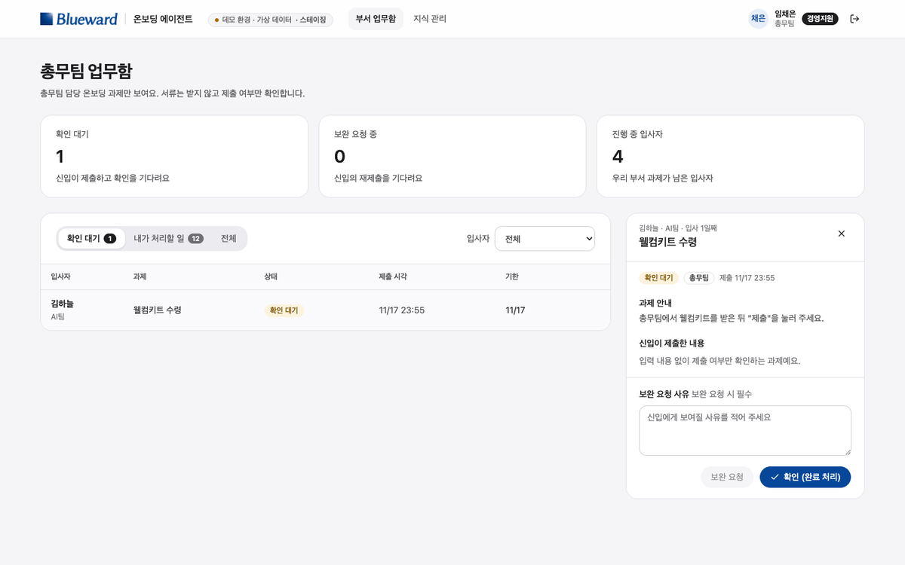
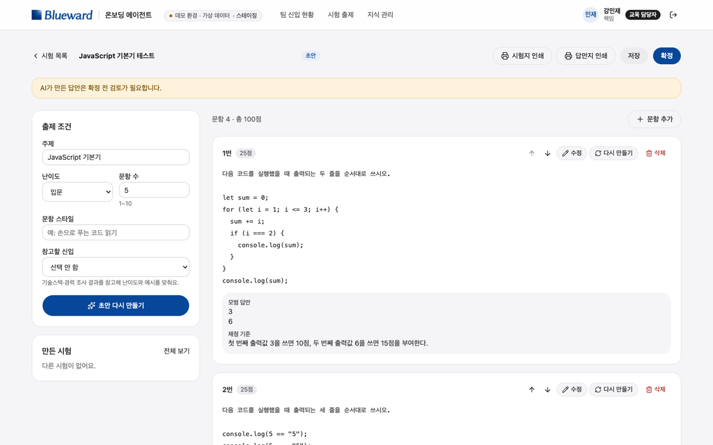
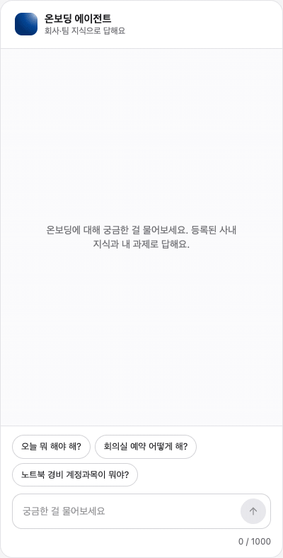

# 온보딩 에이전트

신입 한 명의 온보딩을 하나의 타임라인으로 묶고, 문서에 없는 질문과 반복 설명은 AI 에이전트가 받되, 업무 상태는 사람과 규칙이 지키는 웹 서비스다.

인사·총무·회계 안내와 팀 교육이 따로 전달되고, 담당자는 같은 설명을 반복한다. 이 문제를 풀기 위해 역할 4개(신입·교육 담당자·경영지원·관리자)가 한 서비스에서 과제를 주고받고, 에이전트가 지식 답변과 시험 초안을 맡는다. 차별점은 세 가지다. 근거를 표시하고 모르면 담당자에게 넘기는 에이전트, 업무 상태는 정해진 규칙으로만 바뀌는 구조, 그리고 공개 URL로 실제 운영한다는 점이다. 사내 AI Agent 경진대회 출품작이며, 화면은 회사 CI(Blueward)를 쓰고 사람·계정·과제·지식 데이터는 모두 가상이다. 심사위원 접속 안내는 [심사위원 안내](docs/judge-guide.md)에 있다.

  
  

위: 신입 타임라인과 채팅(근거 표시). 아래 왼쪽: 경영지원 업무함에서 제출 확인·보완 요청. 아래 오른쪽: 교육 담당자의 시험 초안 편집. 모두 스테이징 화면이며 데이터는 가상이다.

## 주요 기능

| 역할 | 기능 |
|---|---|
| 신입 | 입사일·첫 주·첫 달 타임라인에서 경영지원 과제 21개와 팀 과제 10개를 처리한다. 선행 과제가 끝나면 다음 과제가 열리며, 담당자 처리 결과는 새로고침 없이 반영된다. 과제에 붙은 서식은 상세에서 내려받는다. 오른쪽 채팅에서 에이전트에게 묻는다 |
| 경영지원 (인사·총무·회계) | 부서 업무함에서 제출된 과제를 확인하거나 사유와 함께 보완을 요청하고, 담당자 처리 과제를 완료한다. "온보딩 과제"에서 부서 과제와 서식을 관리하고, 입사자 한 명에게만 과제를 추가한다 |
| 교육 담당자 | 팀 신입의 진행과 평가 일정을 보고 결과를 기록한다. "온보딩 과제"에서 팀 과제를 추가·수정·보관하고 신입이 작성할 서식(Word·Excel·PDF)을 올리며, 신입 한 명에게만 과제를 추가한다. 미답변 질문에 답을 등록하고, AI 초안으로 시험지와 답안지를 만든다 |
| 관리자 | 계정을 등록하면(신입은 입사일 기준) 온보딩 과제 31개가 바로 만들어진다. 시연용 데이터를 초기 상태로 되돌린다(올린 서식은 지우고 기본 서식은 유지) |

### 온보딩 어시스턴트 (신입용 채팅)

신입 화면 오른쪽 채팅에서 질문을 입력하면 답이 실시간으로 이어서 나오고, 아래에 근거(사용한 지식·과제)가 붙는다. 응답은 게시된 사내 지식과 신입 본인의 과제만 근거로 삼는다. 근거가 없으면 지어내지 않고 "확인되지 않은 내용이에요."라고 답한다. 신입이 답변 아래 "담당자에게 등록 요청"을 누르면 그 질문이 담당자의 미답변 목록에 올라간다. 신입이 원한 질문만 담당자에게 간다.

담당자가 그 미답변에 답을 등록하면 다음 질문부터 바로 답한다. 예를 들어 신입이 "동호회 가입비 얼마야?"라고 처음 물었을 때는 신입이 등록을 요청하고, 교육 담당자가 답을 등록한 뒤 같은 질문을 하면 등록된 답과 근거를 보여 준다. 문서로 정리되지 않았던 지식이 질문을 통해 쌓인다.

"오늘 할 일"은 신입이 직접 할 과제만 안내하고, 담당자가 처리할 과제는 구분해서 말한다. 과제 완료 같은 처리 요청은 직접 할 수 없다고 안내하고 해당 과제 화면으로 연결한다. 코드 작성이나 시험 답안 요청은 거절한다. 오른쪽 화면은 첫 응답까지의 대기 시간을 줄여서 편집했다.
 

### 시험 출제 도우미 (교육 담당자용)

주제·난이도·문항 수를 넣으면 문제, 모범 답안, 채점 기준, 배점 초안을 받는다. 신입이 제출한 기술스택 조사 결과를 참고할 수 있다. 문항 하나만 다시 만들거나 직접 고친 뒤 순서를 바꿔 저장하며, AI 초안에는 확정 전 검토가 필요하다는 표시를 남긴다. 시험지(답 없음)와 답안지(모범 답안·채점 기준)를 따로 인쇄하거나 PDF로 저장할 수 있고, 신입은 시험 문제와 답안을 볼 수 없다.

## 믿고 쓸 수 있게 한 장치

과제를 완료하거나 보완을 요청하는 일은 화면에서 사람이 누르고, 정해진 규칙에 따라서만 처리된다. 에이전트에게는 업무 상태를 바꾸는 기능이 없으므로 AI가 잘못 판단해도 진행 상황이 망가지지 않는다.

누가 무엇을 볼 수 있는지는 역할로 정해진다. 신입은 본인 과제만, 경영지원 담당자는 자기 부서 과제만 본다. 과제 템플릿 수정은 담당 범위 안에서만 되고, 신입이 진행 중인 과제는 제목·안내문만 고칠 수 있다. 시험 문제와 답안은 교육 담당자만 볼 수 있다. 계정은 관리자만 만들 수 있고 공개 가입은 막혀 있다.

AI 사용 비용에는 상한을 둔다. 로그인한 사용자만 에이전트를 쓸 수 있고, 사용자당 하루 채팅 50회, 시험 생성 10회까지로 제한한다. AI 서비스와 클라우드에는 월 사용 한도와 예산 알림을 건다. 채팅 내용은 저장하지 않는다.

심사위원이 쓰는 운영 환경은 개발 중인 환경과 분리돼 있다. 확인을 마친 버전만 승인을 거쳐 운영에 올라가고, 올라갈 때마다 로그인·권한·화면을 자동으로 점검한다. 공개 기간(한 달) 동안 첫 접속이 느려지지 않도록 서비스를 계속 켜 둔다.

## 만든 방식

기획·결정·머지는 사람이 맡고, 구현과 리뷰는 AI 에이전트가 나눠 처리했다. Claude Code가 공통 기반을 먼저 만든 뒤 신입·담당자·채팅·시험·관리자 기능을 여러 세션이 나눠 병렬로 개발했고, 기능마다 테스트를 먼저 작성했다. 모든 변경은 Codex의 코드 리뷰를 통과해야 반영됐다. 공개 전에는 시연 흐름 전체와 실패 상황(접근 차단, 권한, 장애 시 동작)을 실제 화면에서 점검했고, 결과는 [시연 스크립트](docs/demo-script.md)에 정리했다.

## 확장 계획

| 방향 | 방법 |
|---|---|
| 회사 계정 로그인 | Microsoft 계정(Azure)으로 로그인 |
| Teams에서 묻기 | Teams 봇이 같은 에이전트를 호출 |
| 여러 조직 | 조직별로 데이터를 나눠 계열사·다른 부서로 확대 |
| 입사 전·퇴사 절차 | 같은 과제 구조로 단계를 추가 |

## 더 보기

| 문서 | 내용 |
|---|---|
| [심사위원 안내](docs/judge-guide.md) | 접속, 역할별 계정, 5분 체험 순서, 사용 한도 |
| [시연 스크립트](docs/demo-script.md) | 시연 흐름과 기대 결과, 점검 기록 |
| [구조와 개발 안내](docs/architecture.md) | 아키텍처, 데이터 모델, 보안·권한, 배포, 기술 스택, 로컬 실행 (개발자용) |
