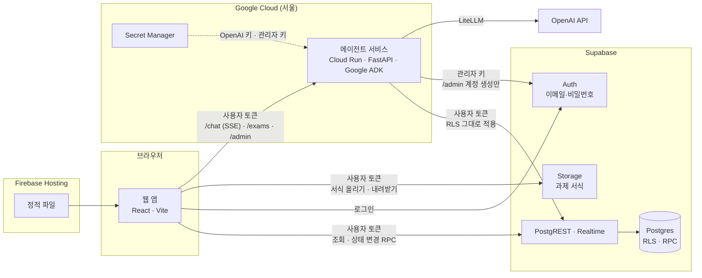
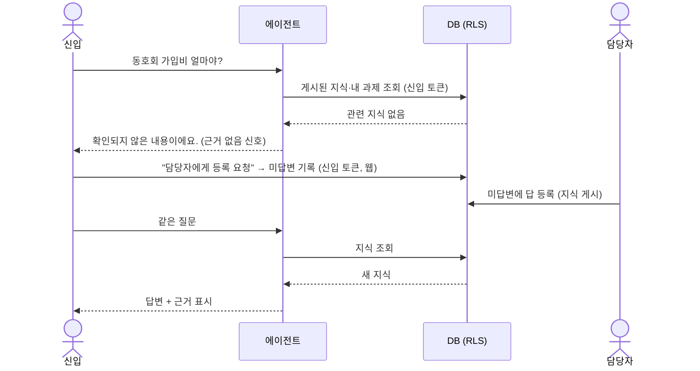
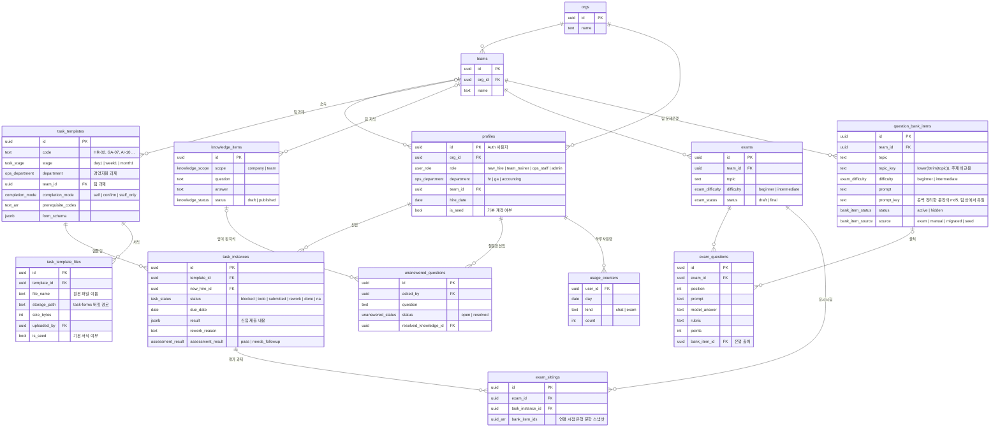
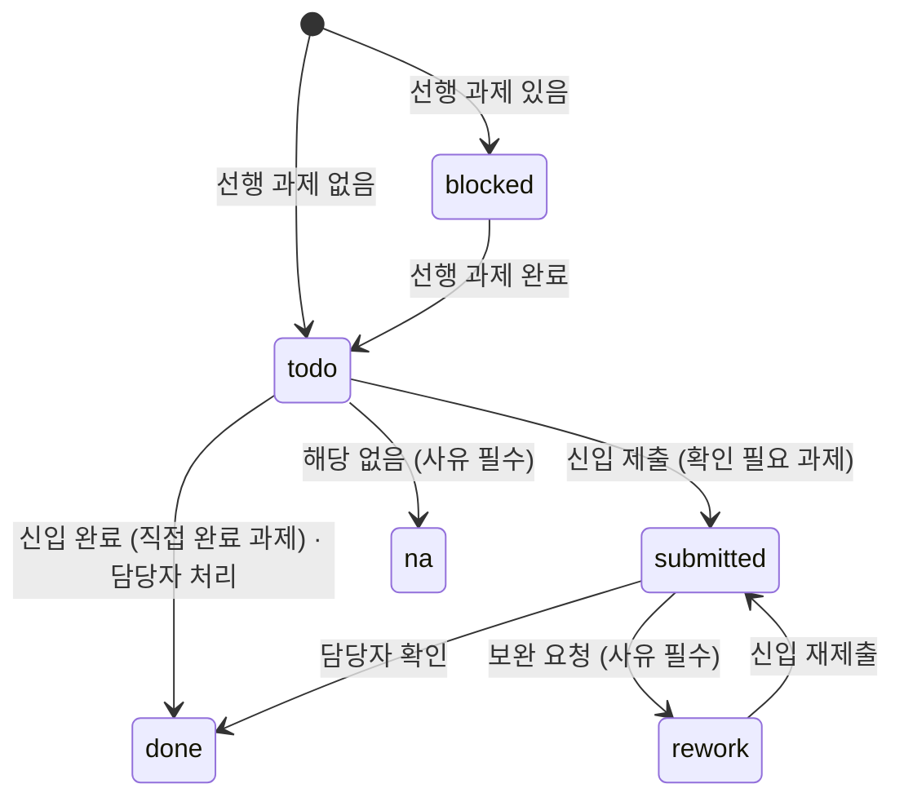

# 구조와 개발 안내

서비스 소개는 [README](../README.md)에 있다. 이 문서는 개발자와 기술 검토를 위한 구조, 데이터 모델, 배포, 로컬 실행 안내다.

## 아키텍처

업무 규칙(과제 상태 전이, 권한)은 DB가 지키고, 에이전트는 조회·답변·초안만 맡는 업무 엔진 + 얇은 에이전트 구조다. DB 함수가 상태를 바꾸므로 LLM이 잘못 판단해도 업무 상태가 망가지지 않는다.

에이전트 서비스는 Cloud Run 위에서 FastAPI와 Google ADK로 돌아가고, OpenAI API 호출은 LiteLLM을 거친다. 브라우저의 웹 앱은 React와 Vite로 만든 정적 파일이며 Firebase Hosting에 올린다. 웹 앱은 사용자 토큰으로 조회·상태 변경 RPC를 호출하고, 로그인할 때는 Auth를 거친다. 사용자 토큰을 담아 /chat(SSE), /exams, /admin 경로를 에이전트 서비스로 보내면, 에이전트는 이 토큰을 그대로 RLS에 적용해 PostgREST와 Realtime을 통해 DB를 조회한다. 관리자 키로는 /admin 계정 생성만 Auth에 요청한다. Secret Manager가 OpenAI 키와 관리자 키를 에이전트 서비스에 넘기고, DB는 Postgres이며 RLS와 RPC로 동작한다.

웹 앱은 역할별 화면으로 구성된다. 데이터는 사용자 토큰으로 Supabase에서 직접 읽고, 과제 상태는 RPC로만 바꾼다. 실시간 구독으로 다른 사람의 처리 결과가 새로고침 없이 반영된다. Supabase는 인증과 데이터, 업무 규칙을 맡는다. 모든 테이블에 RLS를 걸어 역할·부서·팀·본인 범위만 보이게 하고, 공개 가입은 막는다. 에이전트 서비스는 채팅(SSE 스트리밍)과 시험 초안, 관리자 계정 생성 API를 제공한다. 사용자 토큰으로 조회해 RLS가 그대로 적용되며, 상태가 없는 구조다. 대화 이력은 요청에 담겨 올 뿐 저장하지 않는다. LLM은 OpenAI 모델을 쓰되 모델 이름은 환경변수로 바꾼다. ADK와 LiteLLM으로 연결해 특정 모델 전용 기능에 기대지 않는다.



## 지식 순환 흐름

신입이 “동호회 가입비 얼마야?”라고 물으면 에이전트가 신입 토큰으로 게시된 지식과 자신의 과제를 조회한다. DB에 관련 지식이 없으면 에이전트는 확인되지 않은 내용이라고 답하고 근거 없음(`unanswered`) 신호만 보낸다. 에이전트는 아무것도 기록하지 않는다. 신입이 답변 아래 "담당자에게 등록 요청"을 누르고 질문을 확인해 보내면, 웹이 신입 권한으로 미답변을 기록한다. 담당자가 그 미답변에 답을 등록하면 지식이 게시되고, 신입이 같은 질문을 다시 던질 때 에이전트는 지식을 조회해 답변과 함께 근거를 표시한다.



## 데이터 모델

모든 테이블에 `org_id`가 있어 여러 조직으로 넓힐 수 있다. 그림에서는 조직 연결을 일부만 표시했다.



과제 상태는 아래 규칙대로만 바뀌며, 모두 DB 함수(`submit_task`, `confirm_task`, `request_rework`, `mark_na`, `record_assessment`)가 호출자의 역할과 범위를 확인한 뒤 처리한다. 선행 과제가 완료되거나 해당 사항이 없으면 트리거가 다음 과제를 연다. 같은 요청을 두 번 보내도 결과는 같다.



## 보안과 권한

상태 변경은 DB 함수만 담당하고 화면에서 사람이 누른다. 에이전트는 상태를 바꾸는 도구가 없으므로, LLM이 잘못 판단해도 업무 상태가 망가지지 않는다. 에이전트가 답을 만들 때는 도구가 돌려준 지식과 과제에만 근거하도록 지시하고, 근거가 없으면 지어내지 않고 근거 없음 신호만 보낸다(담당자에게 넘길지는 신입이 정한다). 실제 모델 평가 문항으로 이를 확인한다.

모든 테이블에 RLS를 적용한다. 신입은 본인 과제만 볼 수 있고, 시험 문제·답안은 교육 담당자만 볼 수 있다(pgTAP 테스트). 문제은행(`question_bank_items`)과 응시 기록(`exam_sittings`)도 그 팀 교육 담당자만 보며, 은행은 삭제 대신 숨기고 응시 기록은 `assign_exam` 함수로만 쓴다. 과제 서식은 비공개 버킷에 두고, 그 과제의 담당자만 올리고 지우며 같은 조직 사용자는 서명 URL로만 내려받는다. OpenAI 키와 Supabase 관리자 키는 Secret Manager에만 두고, 웹 번들에는 공개 키만 들어간다. 관리자 키는 계정 생성 경로에서만 쓴다. 에이전트 서비스가 토큰의 역할을 확인하고, 초기화 함수는 DB에서 관리자만 실행할 수 있다. 공개 가입은 막는다.

모든 API는 로그인 토큰이 필요하다. 사용자당 하루 채팅 50회, 시험 생성 10회를 DB에서 집계해 막는다. OpenAI 프로젝트 월 한도와 GCP 예산 알림을 둔다. 스테이징과 운영을 다른 클라우드 프로젝트로 나누고, 운영은 버전 태그와 승인으로만 배포한다.

## 배포와 운영

| 환경 | 용도 | 배포 |
|---|---|---|
| PR 미리보기 | 변경마다 화면 확인 | PR을 올리면 스테이징 백엔드에 붙은 미리보기 주소가 PR에 달린다 |
| 스테이징 | 최신 개발 버전, 리허설 | `main`에 머지되면 DB 마이그레이션 → 기본 계정 → 에이전트 → 웹 → 자동 점검 |
| 운영 | 심사위원 접속 | `v*` 태그 + 승인 후 같은 순서로 배포 |

모든 PR은 웹·에이전트·DB 테스트, 배포 스크립트 검사, 미리보기 배포를 통과하고 AI 코드 리뷰(Codex) 지적을 해결해야 머지된다. 배포 뒤 점검 스크립트가 버전, 화면, 로그인, 권한(과제 31개만 보이는지), 공개 가입 차단, 토큰 없는 요청 거부를 확인한다. 운영 에이전트는 최소 1개 인스턴스를 유지해 첫 요청이 느려지지 않게 하고, 무료 플랜 DB는 하루 세 번 자동 요청으로 일시 정지를 막는다.

자세한 절차는 [배포 안내](deploy.md)에 있다.

## 기술 스택

| 영역 | 사용 기술 |
|---|---|
| 웹 | React 19, Vite, TypeScript, Tailwind CSS v4, shadcn/ui, TanStack Query, supabase-js |
| 에이전트 | Python 3.12, FastAPI, Google ADK, LiteLLM, OpenAI API |
| 데이터 | Supabase (Postgres, Auth, Realtime, Storage), RLS, PL/pgSQL 함수 |
| 인프라 | Cloud Run (서울), Firebase Hosting, Secret Manager, GitHub Actions (Workload Identity Federation) |
| 테스트 | Vitest + Testing Library, pytest, pgTAP, 실제 모델 평가 스크립트, 배포 점검 스크립트 |

## 로컬 실행

필요한 도구는 Node 22+, uv, Docker, Supabase CLI다.

```bash
npm --prefix apps/web install          # 웹 의존성
(cd services/agent && uv sync)         # 에이전트 의존성
supabase start && npm run db:reset     # 로컬 DB + 기본 계정 6개 (로컬 비밀번호 demo1234)
npm run dev:web                        # http://localhost:5173
npm run dev:agent                      # http://localhost:8000/health
npm run test:web && npm run test:agent && npm run db:test
```

`.env` 파일은 쓰지 않는다. 로컬 Supabase 값은 `scripts/with-local-env.sh`가 넘긴다.

## 문서

| 문서 | 내용 |
|---|---|
| [심사위원 안내](judge-guide.md) | 접속, 역할별 계정, 5분 체험 순서, 사용 한도 |
| [시연 스크립트](demo-script.md) | 시연 흐름과 기대 결과, 리허설·실패 조건 점검 기록 |
| [설계](superpowers/specs/2026-11-17-onboarding-agent-design.md) | 목표, 비목표, 실패 조건, 결정된 구조 |
| [화면 명세](screens.md) | 화면 S1~S12 |
| [API·환경변수 계약](contracts.md) | 웹·에이전트·DB 사이의 기준 |
| [배포 안내](deploy.md) | 환경 구성, 배포 흐름, 되돌리기, 운영 점검 |
| [구현 계획](superpowers/plans/2026-11-17-onboarding-agent.md) | 작업 단위, 인터페이스, 테스트 |
| [CLAUDE.md](../CLAUDE.md) · [AGENTS.md](../AGENTS.md) · [SECURITY.md](../SECURITY.md) | 구현 규칙, 리뷰 기준, 보안 기준 |
